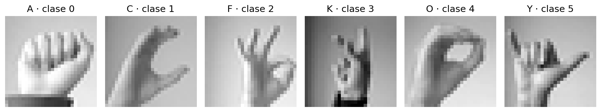
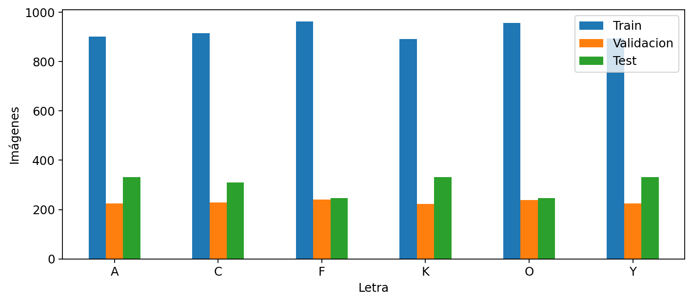
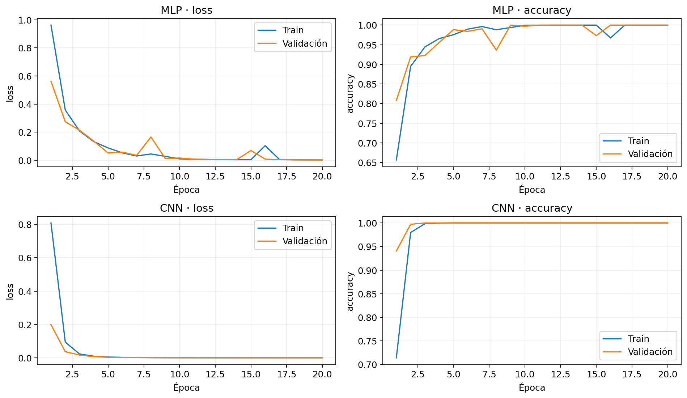
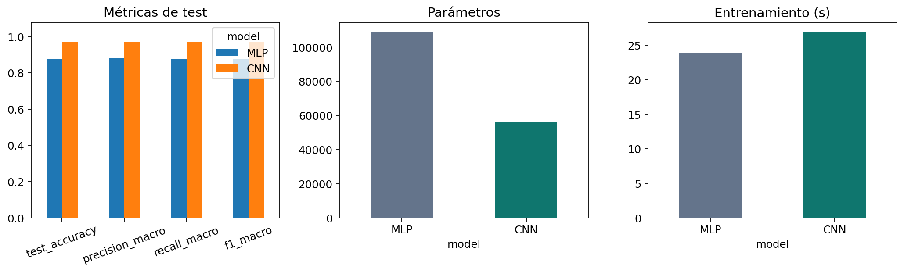
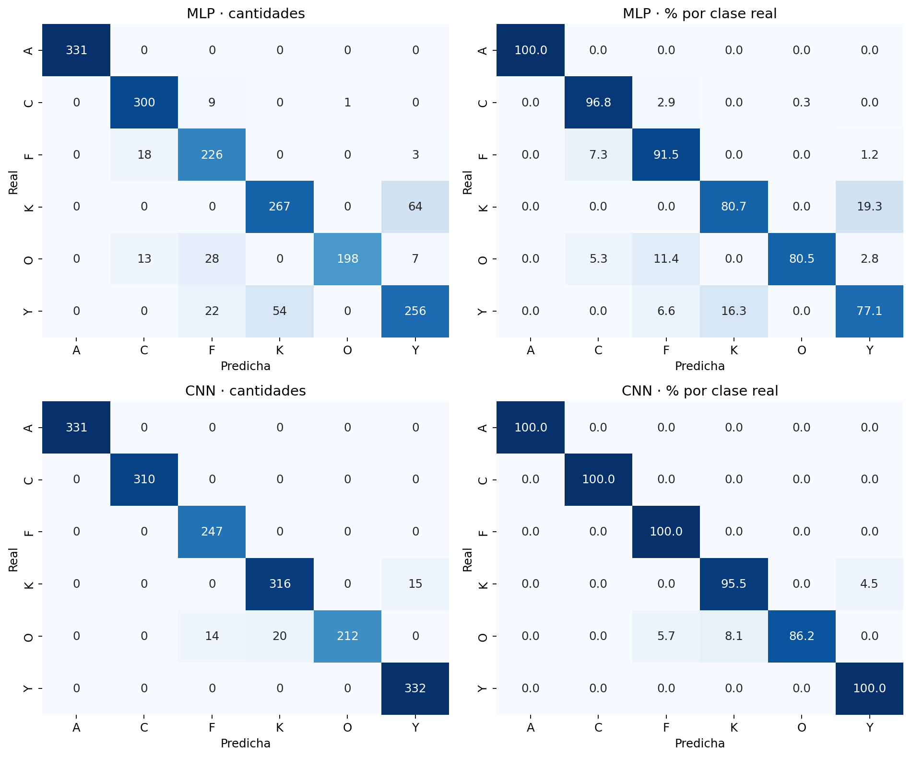
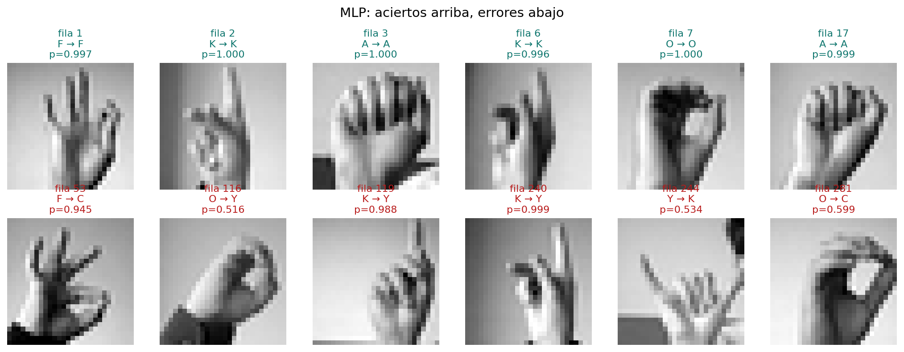
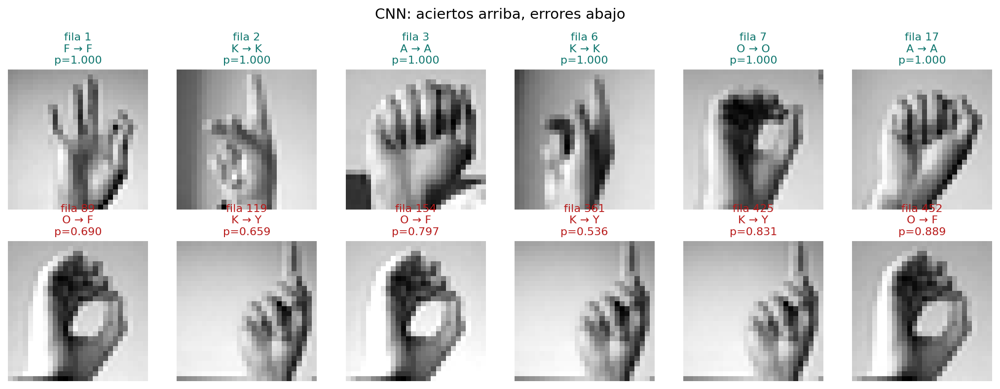
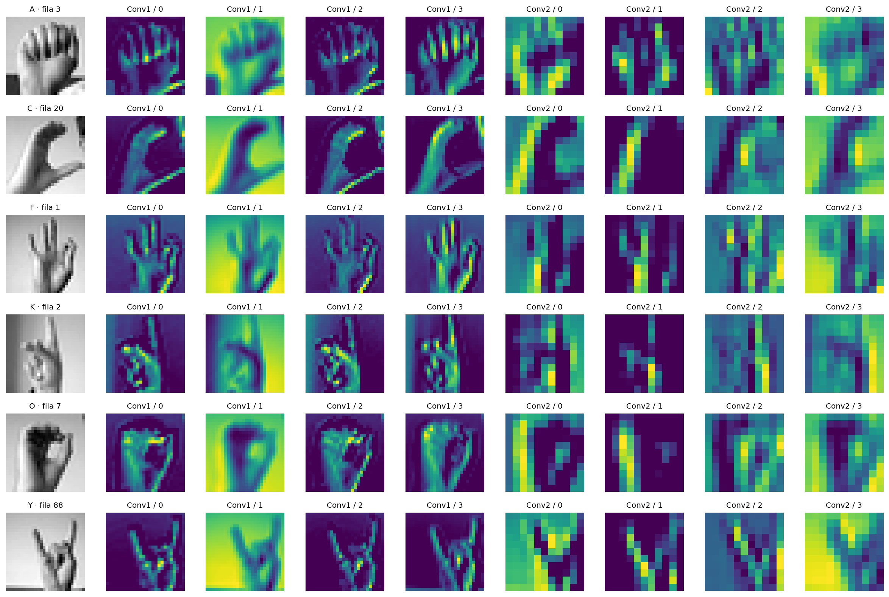
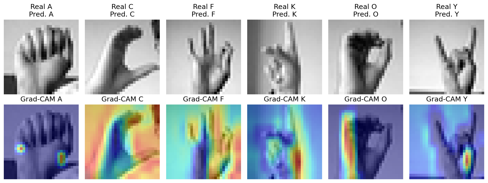

# Evaluación 2: clasificación de letras ASL con CNN y comparación con MLP

**Asignatura:** Técnicas Avanzadas de Machine Learning (TLY1102)  
**Sección:** 001D  
**Docente:** Jazna Hidalgo  
**Integrantes:** Nicolás Fernández Vera, Bastian Gutierrez y Victor Gutierrez  
**Fecha de ejecución:** 10 de octubre de 2026

## Resumen ejecutivo

Se conserva el caso de la evaluación 1: seis letras estáticas **A, C, F, K, O, Y** de Sign Language MNIST. Se entrenó una CNN en TensorFlow/Keras y se reentrenó el MLP original sobre las mismas particiones. La CNN obtuvo **97.27% de accuracy**, **0.9706 de F1 macro** y **49 errores** en 1.797 imágenes. El MLP reentrenado obtuvo **87.81%**, **0.8780** y **219 errores**. La diferencia es **9.46 puntos porcentuales**.

El MLP histórico de E1 obtuvo 87,03%, F1 macro 0,8694 y 233 errores. Se informa por separado para no mezclar ejecuciones. La CNN usa **56.454 parámetros**, frente a **109.126 del MLP** (48,27% menos). En este entorno tomó 27.00 s frente a 23.85 s: menos parámetros no implica menor tiempo de cómputo.

## 1. Problema, objetivo y alcance

El proyecto aborda el reconocimiento automático de seis configuraciones manuales para apoyar un prototipo educativo de letras del alfabeto manual ASL. La entrada es una imagen 28×28 en gris y la salida es una de seis letras. Es una clasificación supervisada multiclase. La oportunidad es facilitar ejercicios y retroalimentación sobre gestos estáticos en condiciones controladas.

El objetivo es comprobar experimentalmente si filtros locales y pesos compartidos mejoran la generalización frente al MLP de E1. La variante se conserva para aislar el cambio de arquitectura. Se eligieron estas seis letras en E1 por disponibilidad de ejemplos y diversidad de configuraciones, manteniendo una complejidad manejable. La solución **no traduce conversaciones ni demuestra reconocimiento de lengua de señas chilena**, tampoco detecta manos en fotografías completas ni rechaza letras fuera de las seis clases. Softmax siempre elige una de las clases conocidas.

## 2. Continuidad y revisión del trabajo previo

Se analizaron el notebook E1, su README y la presentación, además del ejemplo CNN docente y ambos PDF de E2. [Auditoría de fuentes](docs/AUDITORIA_E1.md) documenta las decisiones y discrepancias. La docente se identificó en la presentación E1. La sección se tomó de la indicación del equipo.

E1 utilizó Dense 128 ReLU, Dense 64 ReLU y Dense 6 Softmax, 20 épocas, batch 32, Adam y entropía cruzada sparse. El notebook histórico registra 32,7547 s y la presentación 35,18 s. Se mantiene el registro ejecutado como evidencia histórica, sin usar ninguno para comparar tiempos con la corrida actual.

El ejemplo docente trabaja con CIFAR-10, por lo que se adaptaron dimensiones, canal, clases y salida. Se corrigieron riesgos de normalización repetida, uso del test como validación y referencia fija a otro modelo en la función de predicción del ejemplo.

## 3. Datos, variante y controles

Fuente: Sign Language MNIST, archivos aportados por el grupo. Dataset original: 27.455 train y 7.172 test, 784 intensidades y una etiqueta. Contiene 24 letras estáticas y excluye J y Z. Se filtran 6.902 imágenes del train oficial y 1.797 del test oficial.

| Letra | Original | Codificada | Train | Validacion | Test |
|---|---|---|---|---|---|
| A | 0 | 0 | 901 | 225 | 331 |
| C | 2 | 1 | 915 | 229 | 310 |
| F | 5 | 2 | 963 | 241 | 247 |
| K | 10 | 3 | 891 | 223 | 331 |
| O | 14 | 4 | 957 | 239 | 246 |
| Y | 24 | 5 | 894 | 224 | 332 |

El train filtrado tiene entre 1.114 y 1.204 muestras por clase. No se requiere remuestreo para equilibrar este subconjunto. El test no tiene exactamente igual soporte por clase, por lo que se informa F1 macro además de accuracy.

Los controles ejecutados encontraron cero nulos, intensidades dentro de 0–255, cero duplicados exactos en cada subconjunto filtrado y cero coincidencias exactas entre train/test o train/validación. Se guardaron huellas SHA-256 e índices originales. Esto detecta repetición exacta, **no** similitud por aumento de datos o identidad de sujeto. No existen identificadores de persona que permitan demostrar separación por sujeto.

## 4. Preparación y protocolo sin fuga de test

Se normaliza una sola vez a float32 dividiendo por 255. No se redimensiona la imagen. Las etiquetas 0/2/5/10/14/24 se recodifican a 0/1/2/3/4/5. El MLP recibe `(N,784)` y la CNN `(N,28,28,1)`.

La partición `train_test_split(test_size=0.20, random_state=42, stratify=y)` produce 5.521 imágenes train y 1.381 validación. El test oficial de 1.797 imágenes queda separado del ajuste y monitoreo. Ambos modelos usan las mismas filas y el mismo barajado de lotes. La configuración CNN se fijó antes de evaluar test, sin iterar para mejorar su resultado.

### Arquitecturas y decisiones
**MLP:** arquitectura idéntica a E1, Dense 128 ReLU, Dense 64 ReLU y Dense 6 Softmax (109.126 parámetros). Aplanar no borra valores, pero las capas densas no imponen vecindad ni comparten filtros espaciales.

**CNN:** dos bloques Conv2D + MaxPooling2D. Primer bloque: 16 filtros 3×3, stride 1, padding `valid`, ReLU. Segundo: 32 filtros 3×3, misma configuración. Cada pooling usa ventana y stride 2×2. Salida Flatten, Dense 64 ReLU, Dense 6 Softmax.

| Capa | Salida por imagen | Parámetros |
|---|---|---:|
| Entrada | 28×28×1 | 0 |
| Conv2D 16, 3×3 | 26×26×16 | (3×3×1+1)×16 = 160 |
| MaxPooling2D | 13×13×16 | 0 |
| Conv2D 32, 3×3 | 11×11×32 | (3×3×16+1)×32 = 4.640 |
| MaxPooling2D | 5×5×32 | 0 |
| Flatten | 800 | 0 |
| Dense 64 | 64 | (800+1)×64 = 51.264 |
| Dense 6 | 6 | (64+1)×6 = 390 |
| **Total CNN** | **6 probabilidades** | **56.454** |

Filtros 3×3 detectan patrones locales con pocos pesos. El segundo bloque combina respuestas previas. MaxPooling conserva la mayor activación local, reduce dimensiones y aporta cierta tolerancia a desplazamientos, sin asegurar invariancia absoluta. `valid` evita bordes artificiales y mantiene suficiente resolución. ReLU introduce no linealidad y produce cero para entradas negativas. Flatten conecta mapas y clasificador. Softmax normaliza seis puntajes.

**Protocolo común:** Adam (learning rate 0,001), sparse categorical crossentropy (etiquetas enteras), 20 épocas, batch 32, mismas particiones y semilla. Se evalúan los pesos de la última época, igual que en E1. No hay regularización, augmentation, búsqueda por test ni early stopping. Se mantiene un presupuesto de actualizaciones comparable. Una única semilla no estima la variabilidad entre ejecuciones.

## 5. Entrenamiento y comportamiento

Se fijaron semillas en Keras y operaciones deterministas de TensorFlow. La corrida utiliza TensorFlow 2.20.0 en CPU, dos hilos y oneDNN desactivado. El detalle de entorno está en `results/environment.json`, las dependencias en `requirements.txt` y los historiales completos en CSV.

El MLP pasa de accuracy de entrenamiento 0,6564 y val_accuracy 0,8081 a 1,0000 en ambos. La pérdida de validación baja de 0,5615 a 0,001580, con oscilaciones visibles en épocas 8 y 15. La CNN pasa de 0,7140 / 0,9406 a 1,0000 / 1,0000, y val_loss de 0,198536 a 0,000057. Su convergencia es más estable en esta corrida. Se conservaron las 20 épocas prefijadas sin seleccionar por test.

La exactitud de validación perfecta no demuestra ausencia de sobreajuste. En test, el MLP pierde 12,19 pp respecto al train y la CNN 2,73 pp. La diferencia entre validación aleatoria y test oficial sugiere distinta dificultad o similitud con entrenamiento, sin poder establecer su causa. No se observa divergencia sostenida de val_loss de CNN, pero persiste una brecha de generalización. La loss train del historial promedia lotes durante actualizaciones; la tabla siguiente reevalúa todo train con pesos finales, por eso no son necesariamente iguales.

## 6. Evaluación y comparación cuantitativa

| Indicador | MLP reentrenado | CNN |
|---|---|---|
| Accuracy test | 0.8781 | 0.9727 |
| Precision macro | 0.8836 | 0.9739 |
| Recall macro | 0.8776 | 0.9694 |
| F1 macro | 0.8780 | 0.9706 |
| F1 ponderado | 0.8780 | 0.9723 |
| Loss test | 0.5407 | 0.0799 |
| Parámetros | 109126.0000 | 56454.0000 |
| Entrenamiento (s) | 23.8483 | 26.9969 |
| Errores | 219.0000 | 49.0000 |
| Brecha train-test (pp) | 12.1870 | 2.7268 |
| Latencia mediana (ms) | 2.2328 | 4.7090 |
| Latencia p95 (ms) | 3.9108 | 6.0583 |

Accuracy es la proporción de aciertos; precision por clase indica cuántas predicciones de esa clase son correctas; recall indica cuántas imágenes reales de esa clase se detectan. F1 es la media armónica de precision y recall. Macro promedia clases por igual y weighted pondera por soporte. Todas las métricas se calculan sobre el mismo test.

La CNN elimina **170 de los 219 errores del MLP actual**, una reducción relativa del **77,63%**, y mejora 9,46 pp. Frente a la cifra histórica E1, la mejora descriptiva es 10,24 pp, pero no corresponde mezclar sus tiempos. El MLP conserva valor como referencia sencilla y fue ligeramente más rápido aquí. La CNN ofrece mejor desempeño con menos pesos gracias a localidad y compartición, aunque añade operaciones convolucionales e interpretación más compleja.

### Desempeño por clase de la CNN

| Clase | precision | recall | f1-score | support |
|---|---|---|---|---|
| A | 1.0000 | 1.0000 | 1.0000 | 331.0000 |
| C | 1.0000 | 1.0000 | 1.0000 | 310.0000 |
| F | 0.9464 | 1.0000 | 0.9724 | 247.0000 |
| K | 0.9405 | 0.9547 | 0.9475 | 331.0000 |
| O | 1.0000 | 0.8618 | 0.9258 | 246.0000 |
| Y | 0.9568 | 1.0000 | 0.9779 | 332.0000 |

Los reportes de ambas redes incluyen todos los promedios en `results/report_mlp.csv` y `results/report_cnn.csv`.

### KPIs conservados de E1

| KPI | Objetivo | MLP actual | CNN | Interpretación |
|---|---|---|---|---|
| Accuracy test | ≥90% | 87,81%, no cumple | 97,27%, cumple | Medido en dataset |
| F1 macro | ≥0,88 | 0,8780, no cumple | 0,9706, cumple | No redondear 0,8780 a 0,88 para aprobar |
| Error global | <5% | 12,19%, no cumple | 2,73%, cumple | Meta de negocio más estricta que accuracy ≥90% |
| Inferencia p95 | <10 ms | 3.91 ms, cumple | 6.06 ms, cumple | Solo llamada de modelo en esta CPU |
| Brecha de generalización | Sin umbral definido en E1 | 12,19 pp train-test | 2,73 pp train-test | Se reporta, no se inventa un objetivo |

La latencia usa 100 llamadas individuales, 10 calentamientos y sincronización por `.numpy()`. No incluye cámara, carga, detección de mano ni preprocesamiento. Se conserva como medición local, sin asegurar rendimiento extremo a extremo ni universal.

## 7. Matrices, predicciones y análisis de errores

### Lectura concreta de los resultados y figuras
En la CNN, A y C presentan precision y recall 1,0000. F e Y tienen recall 1,0000, pero reciben falsos positivos de O y K respectivamente. O es la clase más difícil: 212 aciertos de 246, recall 0,8618, aunque su precision es 1,0000 porque ninguna otra clase se predice como O. K presenta 316 aciertos de 331 y recall 0,9547.

Las tres confusiones CNN son **O→K (20)**, **K→Y (15)** y **O→F (14)**. Suman los 49 errores. El MLP reentrenado concentra 118 errores en K↔Y (64 K→Y y 54 Y→K). La CNN reduce esa confusión a 15, pero todavía falla en O. A 28×28, orientación, sombras y posición relativa de los dedos pueden inducir confusión. Esta es una hipótesis visual, no una causa demostrada mediante intervención.

Entre los ejemplos correctos CNN están F (fila 1), K (fila 2), A (fila 3) y O (fila 7). Entre los incorrectos, O→F en fila 89 tiene probabilidad 0,690, K→Y en fila 119 tiene 0,659 y O→F en fila 452 tiene 0,889. Una salida muy segura también puede estar equivocada. Las filas se refieren al CSV de test original, base cero y sin cabecera.

En Conv1, los canales 0, 2 y 3 resaltan diferentes contornos y cambios locales de intensidad alrededor de mano y dedos. El canal 1 muestra una respuesta más extendida. En Conv2, los mapas se vuelven más gruesos y selectivos: el canal 1 presenta zonas localizadas, y otros combinan áreas extensas. Esto concuerda con campos receptivos mayores, sin asignar a cada filtro un concepto fijo.

Grad-CAM varía según clase: A e Y muestran focos cerca de bordes inferiores o laterales de la mano; O destaca una banda a la izquierda de la mano; K concentra mayor activación hacia la zona inferior derecha. C y F presentan respuestas más extendidas, incluyendo fondo. Por tanto, **no se concluye que toda la atención se concentre en los dedos**. La respuesta al fondo es una limitación a investigar con imágenes externas. Estos mapas se normalizan por separado y ofrecen evidencia aproximada, no una explicación causal ni una segmentación.

## 8. Representaciones internas y activación por clase

Conv1 usa 16 filtros y salida 26×26. Conv2 usa 32 filtros y salida 11×11. Se muestran los primeros cuatro canales de cada capa para las seis clases, con ejemplos e índices identificables. El campo receptivo crece de 3×3 a 8×8 al considerar el primer pooling. Las capas profundas combinan respuestas sobre regiones mayores.

Grad-CAM calcula gradientes del logit de cada clase respecto a Conv2, obtiene pesos por promedio espacial, combina canales y aplica ReLU. La salida 11×11 se interpola para superponerla en la entrada. Se calcula para A/C/F/K/O/Y, con una imagen representativa de cada una. Los mapas de filtros y los de clase son conceptos distintos. No se añadió ninguna capa de regularización para obtenerlos.

## 9. Limitaciones, conclusiones y próximos pasos

La evidencia favorece la CNN para **esta variante y esta corrida**: mejora F1 y accuracy, reduce la brecha train-test y errores con 48,27% menos parámetros. Se cumplen los umbrales técnicos de accuracy y F1 de E1. No se garantiza el resultado en otras semillas o poblaciones.

Persisten 34 errores de O y 15 de K. Se prioriza revisar esas clases con imágenes nuevas, distintas personas e iluminación. La presencia de fondo en Grad-CAM requiere comprobar sensibilidad a recortes y escenarios externos. Otros límites son una sola semilla, ausencia de separación por sujeto verificable, baja resolución y solo seis letras. La independencia entre muestras no está demostrada, por lo que no se presenta un intervalo de confianza que suponga observaciones independientes.

Trabajo futuro: repetir semillas en un protocolo fijado, evaluar imágenes externas por sujeto, medir el flujo completo y ampliar a las 24 clases estáticas. Reconocer J/Z o frases exigiría datos temporales y otro diseño. Ninguna de esas extensiones forma parte del resultado entregado.

## 10. Matriz de responsabilidades

| Actividad | Responsable propuesto | Revisor |
|---|---|---|
| Caso, continuidad E1, filtrado, calidad y particiones | Nicolás Fernández Vera | Bastian Gutierrez |
| Arquitectura, hiperparámetros y entrenamiento | Bastian Gutierrez | Victor Gutierrez |
| Métricas, errores y activaciones | Victor Gutierrez | Nicolás Fernández Vera |
| Informe, repositorio y reproducibilidad | Nicolás Fernández Vera | Ambos compañeros |
| Presentación y preparación de preguntas cruzadas | Los tres integrantes | Revisión conjunta |

## 11. Estructura, reproducción y entrega

| Ruta | Contenido |
|---|---|
| `README.md` | Informe técnico |
| `notebooks/Evaluacion2_CNN_MLP.ipynb` | Desarrollo documentado, ejecutado y con figuras |
| `data/` | CSV originales y procedencia |
| `models/` | MLP y CNN entrenados en formato Keras |
| `images/` | Gráficos, ejemplos y activaciones |
| `results/` | Métricas, historiales, predicciones, matrices, entorno y huellas |
| `src/entrenar.py` | Versión ejecutable del código |
| `presentacion/` | Presentación editable para 10 minutos |
| `docs/GUIA_DEFENSA.md` | Guion y preguntas cruzadas |
| `docs/ENTREGA_Y_REPOSITORIO.md` | Instrucciones de ejecución y publicación |
| `docs/referencias/` | Evidencia E1 y pautas aportadas |

## 12. Fuentes utilizadas

- `docs/referencias/TLY1102-E2.pdf`: instrucciones y detalle de entrega.
- PDF de rúbrica en `docs/referencias/`: ponderaciones y penalizaciones.
- Notebook MLP, README y presentación E1 aportados: caso, configuración y resultados históricos.
- `TLY1102_Entrenamiento_CNN.ipynb` aportado: ejemplo docente revisado para adaptar componentes, sin copiar sus resultados CIFAR-10.
- CSV del ZIP Sign Language MNIST aportado por el equipo. Fuente declarada en E1: [Kaggle, datamunge](https://www.kaggle.com/datasets/datamunge/sign-language-mnist).
- Tablas y figuras de esta entrega: ejecución propia del notebook, archivos íntegros en `results/`.
